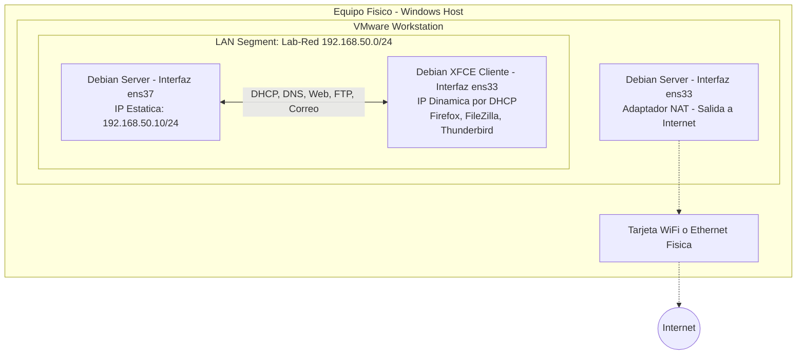

# Guía Integral: Configuración de Red en VMware para Debian Server y Debian XFCE Cliente

Esta guía explica la configuración de red en **VMware Workstation** para interconectar tu **Debian Server** (servidor de servicios) y tu **Debian XFCE** (estación de trabajo cliente con interfaz gráfica).

---

## 1. Arquitectura de Conexión en VMware

Utilizaremos la función **LAN Segment** (o *Host-Only*) de VMware. Los LAN Segments son redes virtuales privadas completamente aisladas de tu máquina física y de tu router WiFi, lo que garantiza que:
- El servidor DHCP que montemos en Debian Server solo entregará direcciones a la máquina Debian XFCE.
- No existirá ninguna interferencia ni corte de señal en tu red doméstica.
- Ambas máquinas se comunicarán a velocidad de bus virtual (máximo rendimiento).



---

## 2. Configuración de Adaptadores en VMware

### 2.1 En la Máquina Virtual: Debian Server
Debian Server necesita dos adaptadores de red:
1. Con la máquina apagada o encendida, haz clic derecho sobre la VM > **Settings...**
2. **Network Adapter (Adaptador 1):** Configúralo en **NAT**. Esto le da salida a internet para `apt update`, `apt install` y `git pull`.
3. Haz clic en **Add...** > selecciona **Network Adapter** > **Finish**.
4. En este nuevo **Network Adapter 2**:
   - Selecciona **LAN Segment**.
   - Haz clic en el botón **LAN Segments...**
   - Escribe el nombre: `Lab-Red` y haz clic en OK.
   - Asegúrate de que quede seleccionado `Lab-Red`.
5. Haz clic en **OK** para guardar.

### 2.2 En la Máquina Virtual: Debian XFCE (Cliente)
Debian XFCE solo necesita una tarjeta conectada al laboratorio:
1. Haz clic derecho sobre Debian XFCE en VMware > **Settings...**
2. **Network Adapter:** Selecciona **LAN Segment** y elige `Lab-Red`.
3. *(Opcional temporal):* Si necesitas instalar herramientas en el cliente (como FileZilla o Thunderbird), puedes ponerla temporalmente en **NAT**, ejecutar `sudo apt update && sudo apt install -y filezilla thunderbird dnsutils ftp curl`, y luego regresarla a **LAN Segment `Lab-Red`**.

---

## 3. Configuración de Red en Debian Server (IP Fija)

Inicia tu Debian Server y abre la terminal.

### Paso 3.1: Identificar las dos tarjetas de red
```bash
ip a
```
Identifica:
- La tarjeta conectada a NAT (ejemplo: `ens33`).
- La tarjeta conectada a `Lab-Red` (ejemplo: `ens37` o `ens38`).

### Paso 3.2: Configurar IP estática `192.168.50.10`
Edita el archivo de interfaces:
```bash
sudo nano /etc/network/interfaces
```
Añade al final:
```text
# Interfaz corporativa conectada a LAN Segment (Lab-Red)
auto ens37
iface ens37 inet static
    address 192.168.50.10
    netmask 255.255.255.0
    broadcast 192.168.50.255
```
Guarda con `Ctrl + O`, presiona Enter y sal con `Ctrl + X`.

Reinicia el servicio de red:
```bash
sudo ifup ens37
# O reinicia la red:
sudo systemctl restart networking
```
Verifica que `ens37` tenga la IP `192.168.50.10` con:
```bash
ip a show ens37
```

---

## 4. Preparación de Debian XFCE Cliente

Inicia tu máquina con Debian XFCE.

### Paso 4.1: Instalación de Paquetes de Prueba en el Cliente
Abre la terminal de Debian XFCE:
```bash
sudo apt update
sudo apt install -y dnsutils ftp filezilla thunderbird curl
```

### Paso 4.2: Configuración para Obtener IP por DHCP
Debian XFCE gestiona la red mediante **NetworkManager**:
- En la esquina superior/inferior derecha, en el ícono de red, verifica que la conexión de cable esté en modo **Automático (DHCP)**.
- O por terminal, simplemente solicita IP con:
  ```bash
  sudo dhclient -r && sudo dhclient -v
  ```

---

## 5. Tabla de Comandos Rápidos: Linux vs. Windows

| Acción de Prueba | En Cliente Linux (Debian XFCE) | En Cliente Windows (CMD/PowerShell) |
| :--- | :--- | :--- |
| **Liberar IP** | `sudo dhclient -r` | `ipconfig /release` |
| **Solicitar IP por DHCP** | `sudo dhclient -v` | `ipconfig /renew` |
| **Ver IP, Gateway y DNS** | `ip a` / `cat /etc/resolv.conf` | `ipconfig /all` |
| **Ver Dirección MAC** | `ip link show` | `getmac` o `Get-NetAdapter` |
| **Consultar DNS Directo** | `nslookup www.empresa.local 192.168.50.10` | `nslookup www.empresa.local 192.168.50.10` |
| **Consultar Registro MX** | `dig @192.168.50.10 empresa.local MX` | `nslookup -type=mx empresa.local 192.168.50.10` |
| **Consultar DNS Inverso** | `dig @192.168.50.10 -x 192.168.50.10` | `nslookup 192.168.50.10 192.168.50.10` |
| **Conexión Web HTTPS** | Firefox: `https://www.empresa.local` | Chrome/Edge: `https://www.empresa.local` |
| **Conexión FTP Consola** | `ftp 192.168.50.10` | `ftp 192.168.50.10` |
| **Cliente FTP Gráfico** | FileZilla (GUI) | FileZilla (GUI) |
| **Cliente de Correo** | Mozilla Thunderbird (GUI) | Mozilla Thunderbird (GUI) |
