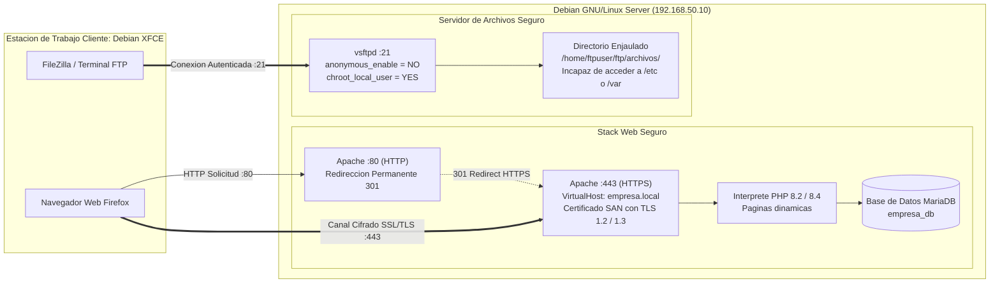

# Reporte Técnico: Tarea 4.2 – Stack de Servicios Web (HTTPS) y Transferencia de Archivos (vsftpd/SFTP)

**Materia:** Administración de Servidores  
**Unidad:** 4 – Servidores DNS, Web, FTP, DHCP, Correos  
**Alumno:** [Nombre del Alumno]  
**Docente:** [Nombre del Docente]  
**Fecha:** Noviembre 2026  
**Servidor:** Debian GNU/Linux 12 (Apache2 + PHP 8.2 + MariaDB + vsftpd)  
**Cliente:** Debian GNU/Linux 12 (XFCE Desktop con Firefox y FileZilla) / Windows  
**Hipervisor:** VMware Workstation (LAN Segment: `Lab-Red`)  

---

## 1. Introducción y Objetivos

El despliegue de aplicaciones modernas en entornos empresariales exige el cumplimiento estricto de dos pilares de seguridad:
1. **Confidencialidad e Integridad en Tránsito (HTTPS):** La capa de transporte de la web debe estar protegida mediante cifrado SSL/TLS robusto, impidiendo ataques de interceptación (*Man-in-the-Middle*) o alteración de datos.
2. **Aislamiento y Principio de Menor Privilegio en Transferencia de Archivos (FTP Seguro):** El almacenamiento remoto de archivos debe impedir accesos anónimos no autorizados y confinar a cada usuario en su directorio asignado (**Chroot Jail**), previniendo que usuarios maliciosos exploren la jerarquía del sistema operativo o descarguen archivos confidenciales como `/etc/passwd` o `/etc/shadow`.

El objetivo de este reporte es documentar el despliegue del stack LAMP (Linux, Apache, MariaDB, PHP) bajo HTTPS con Virtual Hosts y la securización de un servidor **vsftpd** con enjaulamiento chroot.

---

## 2. Topología de Servicios



### Matriz de Servicios y Puertos

| Servicio | Demonio / Software | Puerto(s) | Protocolo / Modo | Seguridad Implementada |
| :--- | :--- | :--- | :--- | :--- |
| **Redirección Web** | Apache2 | TCP 80 | HTTP | Redirección obligatoria 301 a HTTPS. |
| **Portal Web Seguro** | Apache2 + PHP | TCP 443 | HTTPS (TLS 1.2/1.3) | Certificado SSL con SAN, cifrados robustos ECDHE. |
| **Base de Datos** | MariaDB Server | TCP 3306 | Localhost (127.0.0.1) | Usuario dedicado `empresa_user` con privilegios mínimos. |
| **Control FTP** | vsftpd | TCP 21 | FTP / FTPS | Bloqueo anónimo, autenticación local obligatoria. |
| **Datos FTP Pasivo** | vsftpd | TCP 40000-40100 | Rango Pasivo | Puertos restringidos para firewall/NAT. |
| **Aislamiento** | Linux Filesystem | N/A | Chroot Jail | Permisos `nobody:nogroup` no escribible en raíz de jaula. |

---

## 3. Resumen de Archivos de Configuración Comentados

### 3.1 Virtual Host SSL (`/etc/apache2/sites-available/empresa.local-ssl.conf`)
* **DocumentRoot:** `/var/www/empresa.local/public_html`
* **Directivas SSL:**
  ```text
  SSLEngine on
  SSLCertificateFile /etc/ssl/certs/empresa.local.crt
  SSLCertificateKeyFile /etc/ssl/private/empresa.local.key
  SSLProtocol all -SSLv3 -TLSv1 -TLSv1.1
  SSLCipherSuite ECDHE-ECDSA-AES128-GCM-SHA256:ECDHE-RSA-AES128-GCM-SHA256:...
  ```
* **Virtual Host Redirección:** Puerto 80 configurado con `RewriteEngine On` y `RewriteRule ^(.*)$ https://%{HTTP_HOST}%{REQUEST_URI} [L,R=301]`.

### 3.2 Servidor vsftpd (`/etc/vsftpd.conf`)
* **Directivas de seguridad aplicadas:**
  ```text
  anonymous_enable=NO
  local_enable=YES
  write_enable=YES
  local_umask=022
  chroot_local_user=YES
  allow_writeable_chroot=YES
  pasv_enable=YES
  pasv_min_port=40000
  pasv_max_port=40100
  ```

---

## 4. Guía de Evidencias Fotográficas Requeridas para el PDF

> **Instrucciones para el Alumno:**  
> A continuación se detallan las **6 capturas exactas** que debes incluir en tu memoria técnica de la Tarea 4.2:

---

### 📸 Evidencia 1: Estado Activo de los Servicios Web y Base de Datos (Apache2 y MariaDB)
* **Comando en Debian Server:**
  ```bash
  sudo systemctl status apache2 mariadb --no-pager
  ```
* **Qué debe verse:** Ambos servicios en color verde mostrando el estado `active (running)`.

  
*Figura 2.1: Confirmación de operatividad del servidor HTTP Apache y el motor relacional MariaDB.*

---

### 📸 Evidencia 2: Navegación Segura HTTPS y Portal Dinámico PHP/MariaDB
* **Acción en el Cliente (Debian XFCE):** Abrir Firefox e ingresar a `https://www.empresa.local`.
* **Qué debe verse:** La página web corporativa mostrando el banner azul de **🔒 HTTPS (Cifrado Activo)**, la versión de PHP detectada y el recuadro verde con la leyenda **Conectado exitosamente a MariaDB**.

  
*Figura 2.2: Carga exitosa del portal web interactivo bajo canal cifrado HTTPS y conexión activa a MariaDB.*

  
*Figura 2.2b: Consulta exitosa a la base de datos empresa_db retornando registros en formato JSON.*

---

### 📸 Evidencia 3: Inspección Visual del Certificado SSL/TLS (Nombres SAN)
* **Acción en el Cliente (Debian XFCE):** Clic en el candado del navegador Firefox > **Ver Certificado / Detalles**.
* **Qué debe verse:** El visor de certificados mostrando el sujeto `CN = empresa.local`, Organización `Empresa Corporativa S.A.`, y el periodo de validez activo.

  
*Figura 2.3: Validación criptográfica de la entidad emisora y los nombres alternativos del certificado.*

---

### 📸 Evidencia 4: Estado Activo del Servidor FTP Seguro (vsftpd)
* **Comando en Debian Server:**
  ```bash
  sudo systemctl status vsftpd --no-pager
  ```
* **Qué debe verse:** El demonio `vsftpd` en estado `active (running)` escuchando en el puerto 21.

  
*Figura 2.4: Demonio FTP de Debian Server activo y listo para conexiones seguras.*

---

### 📸 Evidencia 5: Autenticación y Conexión de Usuario al Servidor FTP
* **Comando en el Cliente (Debian XFCE):**
  ```bash
  ftp 192.168.50.10
  ```
  Ingresar usuario: `ftpuser` y contraseña: `Alumno123`.
* **Qué debe verse:** Respuesta del servidor `230 Login successful` y establecimiento del modo binario.

  
*Figura 2.5: Acceso validado para ftpuser tras superar el filtro PAM del sistema operativo.*

  
*Figura 2.5b: Conexión y transferencia exitosa de archivos mediante la interfaz de FileZilla en Debian XFCE.*

---

### 📸 Evidencia 6: Demostración de Enjaulamiento (Chroot Jail)
* **Acción en el Cliente (Terminal FTP):**
  - Ejecutar `pwd` (muestra `/`).
  - Ejecutar `cd ..` (permanece confinado en `/`).
  - Ejecutar `cd /etc` (el servidor bloquea el escape arrojando `550 Failed to change directory`).
* **Qué debe verse:** El confinamiento estricto dentro de la jaula chroot impidiendo acceder a directorios sensibles del sistema host.

  
*Figura 2.6: Evidencia del aislamiento del usuario impidiendo explorar el sistema operativo host.*

---

## 5. Conclusiones Técnicas

1. **Seguridad Web Criptográfica:** El empleo de TLS moderno junto con la redirección permanente elimina el riesgo de envío de credenciales o sesiones en texto plano, mientras que los certificados con SAN garantizan compatibilidad completa con navegadores modernos.
2. **Defensa en Profundidad con Chroot:** El enjaulamiento de usuarios en `vsftpd` representa una técnica de contención de primer nivel: incluso si las credenciales de un usuario FTP fueran comprometidas, el atacante queda atrapado en un sandbox sin posibilidad de leer archivos de configuración, llaves privadas SSL o binarios del sistema.
3. **Integración Completa del Stack:** Se validó exitosamente la interacción entre el servidor web, el motor de base de datos relacional y el subsistema de almacenamiento de archivos.

---

## 6. Enlaces de Entrega

* **Repositorio Público de GitHub:** `https://github.com/[Tu_Usuario]/[Tu_Repositorio]/tree/main/Unidad_4/Tarea_4.2`
* **Video Demostrativo en YouTube:** `https://youtu.be/[ID_DE_TU_VIDEO]`
