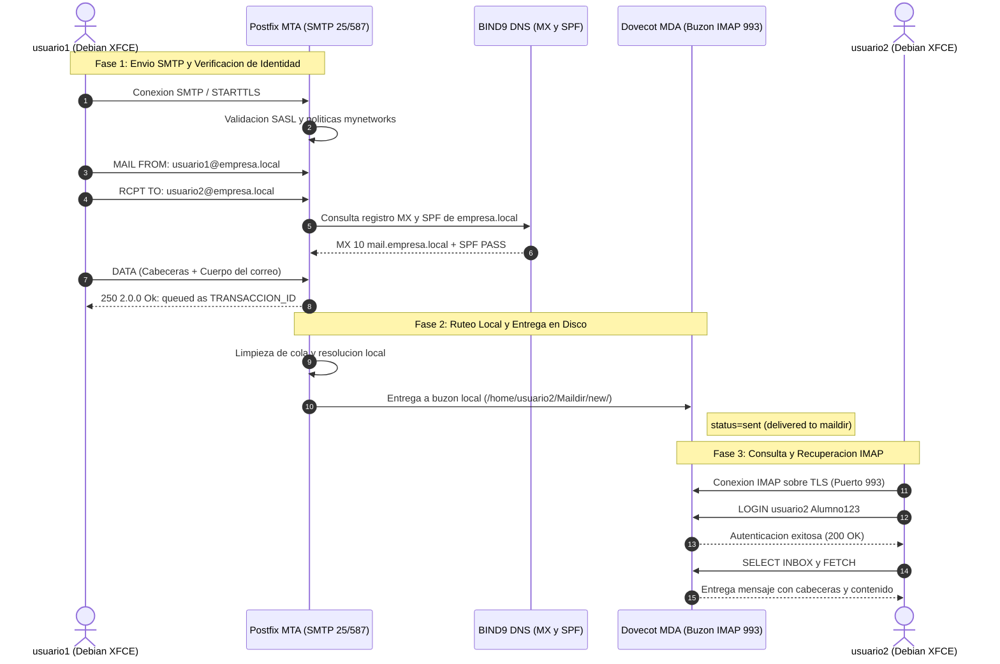

# Reporte Técnico: Tarea 4.3 – Servidor de Correo Electrónico Seguro (Postfix MTA + Dovecot MDA)

**Materia:** Administración de Servidores  
**Unidad:** 4 – Servidores DNS, Web, FTP, DHCP, Correos  
**Alumno:** [Nombre del Alumno]  
**Docente:** [Nombre del Docente]  
**Fecha:** Noviembre 2026  
**Servidor:** Debian GNU/Linux 12 (Postfix + Dovecot + TLS)  
**Cliente:** Debian GNU/Linux 12 (XFCE Desktop con Mozilla Thunderbird) / Windows  
**Hipervisor:** VMware Workstation (LAN Segment: `Lab-Red`)  

---

## 1. Introducción y Objetivos

El sistema de mensajería electrónica es uno de los servicios más sensibles en redes empresariales. Su diseño requiere desacoplar dos responsabilidades fundamentales:
1. **Agente de Transferencia de Correo (MTA - Mail Transfer Agent):** Encargado de la transmisión, ruteo y recepción de mensajes a nivel de red mediante el protocolo **SMTP**. Para esta función se implementa **Postfix**.
2. **Agente de Entrega de Correo (MDA - Mail Delivery Agent):** Encargado del almacenamiento físico de los correos en buzones individuales y de proveer acceso seguro a los usuarios finales mediante el protocolo **IMAP**. Para esta función se despliega **Dovecot**.

El objetivo de esta práctica es desplegar la infraestructura completa de correo bajo el dominio `empresa.local`, configurando el formato de buzones `Maildir/`, cifrado TLS, autenticación SASL, registros DNS de intercambio (MX) y políticas de validación de origen (SPF), demostrando la trazabilidad del flujo de entrega a través de logs en tiempo real.

---

## 2. Diagrama de Flujo de Mensajería Electrónica

El siguiente diagrama detalla la ruta de punta a punta que sigue un correo desde que el remitente lo redacta hasta que es leído por el destinatario:



---

## 3. Arquitectura del Sistema de Correo

### Componentes y Protocolos Implementados

| Componente | Software | Rol en la Arquitectura | Protocolo / Puerto | Seguridad / Formato |
| :--- | :--- | :--- | :--- | :--- |
| **MTA** | Postfix | Agente de Transferencia de Correo | SMTP (TCP 25) / Submission (TCP 587) | Cifrado TLS + SASL Auth Dovecot. |
| **MDA** | Dovecot | Agente de Entrega y Acceso a Buzón | IMAP (TCP 143/993) | SSL/TLS (`imaps`), formato `Maildir/`. |
| **DNS MX** | BIND9 | Intercambiador de Correo | DNS UDP 53 | Prioridad 10 -> `mail.empresa.local`. |
| **DNS SPF** | BIND9 | Validación de Origen de Correo | Registro TXT DNS | `v=spf1 mx ip4:192.168.50.10 ~all`. |
| **Buzones** | Linux FS | Almacenamiento no monolítico | Filesystem | `~/Maildir/{cur,new,tmp}` (Evita bloqueos mbox). |

---

## 4. Guía de Evidencias Fotográficas Requeridas para el PDF

> **Instrucciones para el Alumno:**  
> A continuación se detallan las **6 capturas exactas** indispensables que deben figurar en el documento de entrega:

---

### 📸 Evidencia 1: Resolución de Registros DNS de Correo (MX, A y SPF)
* **Comandos en el Cliente (Debian XFCE):**
  ```bash
  dig @192.168.50.10 empresa.local MX +short
  nslookup mail.empresa.local 192.168.50.10
  dig @192.168.50.10 empresa.local TXT +short
  ```
* **Qué debe verse:**
  - El registro MX devolviendo `10 mail.empresa.local.`
  - El registro A de `mail.empresa.local` apuntando a `192.168.50.10`.
  - El registro TXT mostrando la directiva SPF autorizando a la IP del servidor: `"v=spf1 mx ip4:192.168.50.10 ~all"`.

  
*Figura 3.1: Verificación de los registros DNS indispensables para la interoperabilidad de correo.*

---

### 📸 Evidencia 2: Estado Activo y Carga de Servicios Postfix y Dovecot
* **Comandos en Debian Server:**
  ```bash
  sudo systemctl status postfix dovecot --no-pager
  ```
* **Qué debe verse:** Ambos servicios en color verde mostrando el estado `active (running)`.

  
*Figura 3.2: Confirmación de operatividad de los agentes MTA y MDA en Debian Server.*

---

### 📸 Evidencia 3: Transacción SMTP de Envío de Correo (Swaks)
* **Acción en el Cliente o Servidor:**
  ```bash
  swaks --to usuario2@empresa.local \
        --from usuario1@empresa.local \
        --server 192.168.50.10 \
        --header "Subject: Prueba de Entrega - Unidad 4 Tarea 4.3" \
        --body "Hola usuario2, este es un mensaje de prueba para verificar la entrega local en Maildir."
  ```
* **Qué debe verse:** Diálogo SMTP completo con códigos 250, autenticación y confirmación final `250 2.0.0 Ok: queued as ...`.

  
*Figura 3.3: Negociación SMTP y aceptación del mensaje en la cola de Postfix.*

---

### 📸 Evidencia 4: Trazabilidad en Tiempo Real en los Logs de Postfix
* **Comando en Debian Server:**
  ```bash
  sudo journalctl -u postfix -n 25 --no-pager
  ```
* **Qué debe verse:** La secuencia completa de logs: `connect`, `cleanup`, `qmgr: from=<usuario1@empresa.local>` y la línea clave:
  `postfix/local[...]: to=<usuario1@empresa.local>, relay=local... status=sent (delivered to maildir)`.

  
*Figura 3.4: Registro del sistema certificando la entrega efectiva en el buzón Maildir del destinatario.*

---

### 📸 Evidencia 5: Recepción del Correo en el Buzón Físico (`Maildir/new`)
* **Comando en Debian Server:**
  ```bash
  sudo ls -la /home/usuario2/Maildir/new/
  sudo sh -c 'cat /home/usuario2/Maildir/new/*'
  ```
* **Qué debe verse:** El archivo físico generado dentro de `new/`, con el asunto, remitente, identificador de cola y cuerpo legible.

  
*Figura 3.5: Almacenamiento del mensaje en formato individual Maildir en el directorio del destinatario.*

---

### 📸 Evidencia 6: Visualización del Correo en Cliente MUA (Mozilla Thunderbird en Debian XFCE)
* **Acción en el Cliente Debian XFCE:**
  - Abrir Mozilla Thunderbird con la cuenta `usuario2@empresa.local` configurada con IMAP sobre TLS.
  - Mostrar la **Bandeja de entrada** con el correo recibido.
  - Enviar una respuesta hacia `usuario1@empresa.local` comprobando la bidireccionalidad.

  
*Figura 3.6: Recuperación del mensaje mediante el protocolo IMAP bajo TLS en cliente gráfico.*

  
*Figura 3.6b: Envío de correo de respuesta bidireccional hacia usuario1 verificado en la carpeta Sent.*

---

## 5. Conclusiones Técnicas

1. **Ventajas del Formato Maildir frente a Mbox:** La elección de `home_mailbox = Maildir/` previene condiciones de carrera y bloqueos de archivos en el sistema operativo (*file-locking*), ya que cada correo es un archivo independiente con identificador único.
2. **Importancia de los Registros SPF y MX:** Un servidor de correo no puede operar de forma aislada sin una adecuada integración con el DNS. El registro MX encamina el tráfico hacia el host receptor, mientras que las políticas SPF mitigan la suplantación de identidad (*spoofing*).
3. **Seguridad Criptográfica en la Entrega:** La combinación de Postfix con cifrado STARTTLS y Dovecot con SSL/TLS en IMAP asegura que las contraseñas y contenidos nunca viajen en texto claro por la red.

---

## 6. Enlaces de Entrega

* **Repositorio Público de GitHub:** `https://github.com/[Tu_Usuario]/[Tu_Repositorio]/tree/main/Unidad_4/Tarea_4.3`
* **Video Demostrativo en YouTube:** `https://youtu.be/[ID_DE_TU_VIDEO]`
